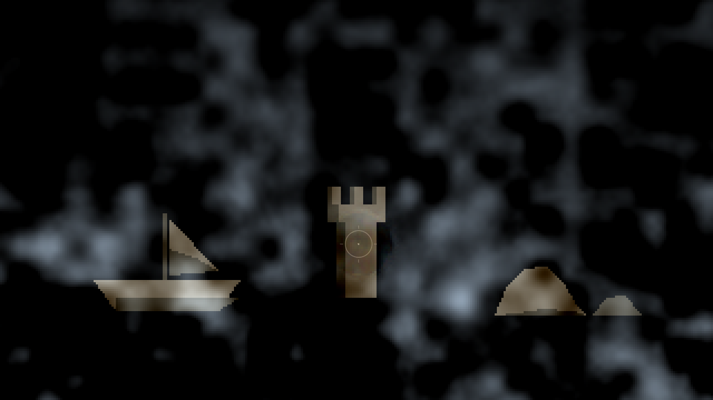
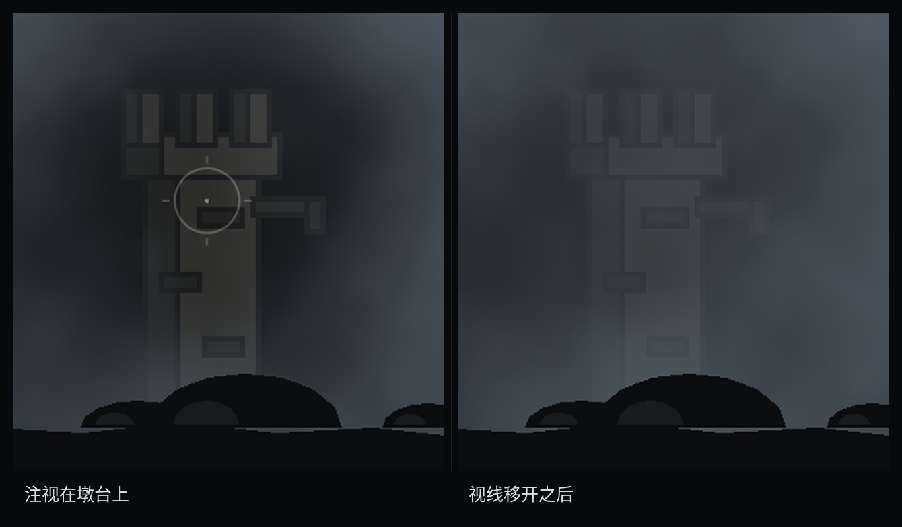

# 从雪花屏到雾

## 一 我要的

雾里有一团东西，你盯着那一块看，雾会退开，东西显出轮廓；眼睛一移开，它马上糊回去。整幅画面还不能停——累积几秒就收敛成一张清晰照片的话，前面那条当场作废。

## 二 第一版

第一版跑起来是满屏雪花。截图看不出来——静态就是这样，一屏黑白分明的大块斑，边缘是硬的，像霉斑铺在镜头上。

真正的问题是它每一帧都在换：每一帧都是新长出来的一组，整片背景在闪。雾里三个东西倒是都看得见——船、墩台、礁石，亮得像被灯照着，轮廓比雾本身还清楚。而把注视点压上去，那一块没有变得更清楚，反而多蒙了一层均匀的灰，比不盯还糊。

这两句现象互相对不上：雾挡不住东西，注视又让东西变差。我一开始当它是两个 bug。

## 三 错在哪

是同一个错。累积能做的事只有一件：把每一帧里不一样的成分平均掉。它抹的是方差。而我想要的"看不清"是均值——雾遮住多少光，是一个每帧都大致相同的量。拿一个抹方差的工具去干一件靠均值的事，两边都不对。

雪花是这么来的。施工令里写着"雾必须持续变化"，怕雾停住之后累积收敛成静止图。我照着这句话，让噪声的相位每帧重抽——`floor(t * 22.0)`，一秒换二十二张互不相关的随机图。累积对不相关的信号只能取到它的期望，而那张图我是按零均值设计的，还指望着累积把雾擦干净。零均值的期望是零，零就是透明：它在任何一帧的均值上都挡不住东西，只在没收敛的那些帧里把画面搅乱；收敛完剩下的是均匀的灰，看起来就像注视点往画面上蒙了层脏的。

雾要"动"，动的是形，不是均值。我把整幅每一帧都做成新的，等于亲手把雾做成了雪花。

施工令那四条我一条没改：双缓冲、按注视距离衰减、320×180、雾必须持续变化。它没写错，只是没说清"变化"变的是哪一层；我也没问。

## 四 改法

闪烁层改成零均值、峰值 0.08，时间上必须连续——用值噪声慢慢漂，不再逐帧换相位。它照样进累积，累积把它抹到接近透明，剩下唯一的作用是让画面不稳。底雾层换成正均值，并且从累积里拿出去，因为正均值永远不会被抹成透明：它在解出颜色之后才叠上去，按注视点做一张软遮罩，圈外 0.78、圈内 0.14。

代价很具体。为了让零均值信号在 8 位缓冲里存得住，场景得抬到 0.5 的底座再压回九成的动态范围，暗部台阶因此变粗；底雾不进累积，就拿不到累积那层免费的时间平滑，它自己必须画得够慢够软，否则一眼是砂纸；一张硬擦薄的圆形遮罩，落在均匀灰场上必然显出一块被擦干净的斑——第一版拆完就是这样，像有人举着手电。后来把雾分三个平面（远岸、近帘、月光），边界用两倍频揉开、跟着雾自身的结构走，斑才淡下去，但没有消失。

还有一处我没做到。要求是一秒钟内看不出雾在变；时间系数除以十之后，整幅画面两秒的差只剩 0.9/255，雾等于冻住，而雾一冻住，累积就收敛成静止图。我把闪烁层的相位推进砍掉了，结构漂移退回到接近原来的速度——做到的是"一秒内看不出雾在变形"，不是"看不出雾在流"。

## 五 还不满意

糊住之后，那座墩台还是认得出是墩台。右半张里垛口那排方齿即使压到很低的对比，仍然是一条读得出来的边。铁律写的是"看得出有东西，认不出是什么"，现在只有前半句成立。让雾去打断剪影的轮廓大概有用，可雾在近景之下、近景又是故意不糊的，这两边在打架，我还没想清楚怎么让。

雾是分成两半才成立的：一半负责让画面不稳，一半负责让画面不透明。这两件事从头到尾就不是一件事。
